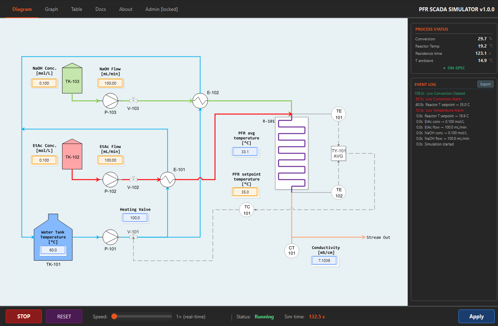
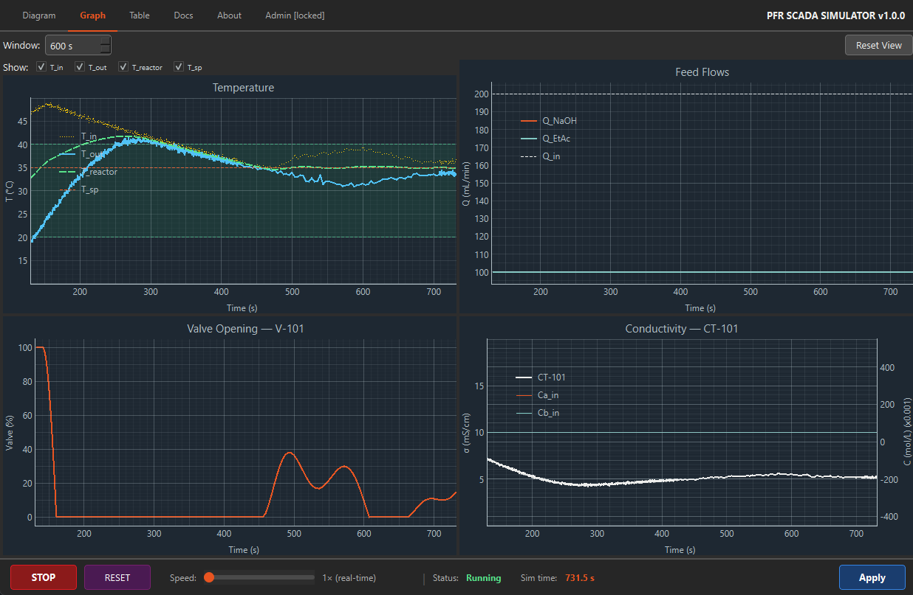

# PFR SCADA Simulator

A real-time SCADA application that simulates a **Plug Flow Reactor (PFR)** with
temperature control, dual-feed streams, and conductivity sensing. Built for
chemical engineering education — generates realistic synthetic process data when
physical equipment is unavailable.





---

## Features

- **Realistic PFR physics** — Method of Lines spatial discretization (N = 50
  nodes), bimolecular Arrhenius kinetics (saponification of EtAc by NaOH),
  non-adiabatic wall heat loss
- **Dual feed streams** — independent NaOH (A) and EtAc (B) flow and
  concentration setpoints
- **PID temperature control** — hot-water heat exchanger upstream of the PFR,
  gains tunable at runtime via the P&ID diagram
- **Sensor imperfections** — Gaussian noise on TE-101 / TE-102 (σ = 0.3 K),
  calibration curve on CT-101 conductivity transmitter
- **Real-time P&ID diagram** — clickable equipment opens parameter dialogs
- **2×2 live plots** — temperature + setpoint, valve %, feed flows,
  conductivity with inlet concentrations
- **Alarm system** — HIGH/LOW temperature and conversion alarms with hysteresis,
  unbounded event log
- **Student-facing Table tab** — flows in mL/min, one-click CSV / Excel export
- **Password-protected Admin tab** — conversion plot and full internal variable
  table with export
- **Windows one-folder executable** — no Python installation required

---

## Quick Start

### Run the pre-built executable (Windows)

```
dist/PFR_SCADA_Simulator/PFR_SCADA_Simulator.exe
```

### Run from source

```bash
pip install -e .
python -m scada_app.main
```

### Build the Windows executable

```bash
pip install pyinstaller
pyinstaller PFR_SCADA_Simulator.spec
# Output: dist/PFR_SCADA_Simulator/
```

macOS and Linux builds must be run on those platforms.

---

## Physical System

The simulated plant is a **saponification reactor** (NaOH + EtAc → NaAc + EtOH):

| Component | Specification |
|---|---|
| Reactor | Tube, L = 20.9 m, D = 5 mm, N = 50 spatial nodes (MOL) |
| Heat exchanger | Hot-water shell-and-tube upstream of PFR; UA_max = 100 W/K; T_hw = 60 °C |
| CT-101 | Conductivity transmitter tracking residual NaOH at outlet; σ = A·C + B |
| TE-101 / TE-102 | Inlet / outlet thermocouples; Gaussian noise σ = 0.3 K |
| Kinetics | k₀ = 1.146×10⁴ m³/(mol·s), Eₐ = 46 kJ/mol (literature saponification) |
| Conversion range | ≈ 31 % at 20 °C → 60 % at 40 °C → 72 % at 50 °C |

---

## Project Structure

```
chemical-engineering/
├── scada_app/                ← SCADA application (PyQt6 UI + simulation engine)
│   ├── engine/               ← SimulationEngine, DataStore, EngineSnapshot
│   ├── ui/                   ← tabs, dialogs, widgets, panels
│   ├── app.py                ← MainWindow
│   ├── constants.py          ← all physical constants and defaults
│   └── main.py               ← entry point
│
├── reactor_simulation/       ← Physics package (reusable, framework-independent)
│   ├── core/                 ← PFRSimulator, reactor types, kinetics, state
│   ├── actuators/            ← HeatExchanger, Heater, Pump
│   ├── control/              ← PIDController
│   ├── sensors/              ← ConductivitySensor, TemperatureSensor, Thermocouple
│   └── simulation/           ← Experiment, perturbations (batch/script mode)
│
├── examples/                 ← Standalone batch simulation scripts
├── tests/                    ← pytest test suite
├── legacy/                   ← Archived modules (kept for reference)
├── images/                   ← P&ID diagram, mask PNGs, UI design sources
└── docs/                     ← Developer documentation
```

---

## Documentation

| Document | Contents |
|---|---|
| [FRONTEND.md](docs/FRONTEND.md) | UI architecture, all tabs and dialogs, engine tick sequence, data flow |
| [BACKEND.md](docs/BACKEND.md) | Physics package structure, class reference, design philosophy |
| [MATH.md](docs/MATH.md) | PDE model, bimolecular kinetics, Method of Lines, numerical integration |
| [QUICKSTART.md](docs/QUICKSTART.md) | Import patterns and common workflows for the script (batch) API |
| [CHANGELOG.md](CHANGELOG.md) | Version history |
| [examples/README.md](examples/README.md) | Script-mode example descriptions |

---

## Citation

If you use this simulator in coursework or research, please cite:

> Villegas G., M. (2026). *PFR SCADA Simulator v1.0.0* [Software].
> Universidad de Santiago de Chile. Department of Chemical Engineering.

---

## Author

**Marco Villegas G.** — MSc Chemical Engineering, Professor at USACH
